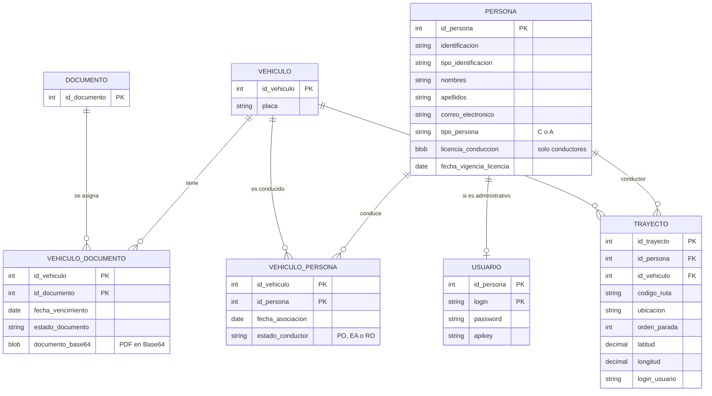

# Vehículos, Documentos y Trayectos · API REST

API REST para gestionar **vehículos, documentos legales, conductores y rutas**. Incluye seguridad con **JWT + API Key**, tareas programadas, geocodificación con **Google Maps** y una interfaz web que dibuja las rutas en un mapa.

Proyecto académico de *Profundización en Programación Orientada a Objetos II* · Ingeniería de Sistemas, Universidad del Tolima (IDEAD).


## Estado del proyecto

| Entrega | Contenido | Estado |
|---|---|---|
| 1 | Vehículos, documentos y su relación: CRUD, búsquedas y validaciones |  Completa |
| 2 | Personas, usuarios, conductores por vehículo, seguridad JWT + API Key y consultas públicas |  Completa |
| 3 | Trayectos, tareas programadas, Google Maps, consultas de rutas e interfaz web |  Completa |
| 4 | Cargue masivo de trayectos desde Excel con procedimientos almacenados |  En desarrollo |


## Funcionalidades

### Entrega 1 · Vehículos y documentos
- CRUD de vehículos y de documentos.
- Un vehículo debe tener **al menos un documento**; los documentos asociados inician en estado *En verificación*.
- Búsquedas por placa, tipo de vehículo, documento y estado del documento.
- Validación de placa con una anotación propia (`@PlacaValida`).
- Carga de documentos en **PDF codificados en Base64** (se verifica que el contenido sea un PDF), guardados como `LONGBLOB`.

### Entrega 2 · Personas, usuarios y seguridad
- CRUD de personas: conductor (`C`) o administrativo (`A`). Al crear un administrativo se genera su **usuario** automáticamente (login con regla nemotécnica, contraseña y API Key).
- Asociación de conductores a vehículos con estado `PO` (puede operar), `EA` (en espera de aprobación) o `RO` (restringido para operar).
- Cambio de contraseña y regeneración de API Key.
- Inicio de sesión con **JWT**; todo servicio, salvo los públicos, exige token **y** API Key.
- Cinco consultas públicas (sin token).

### Entrega 3 · Trayectos
- Creación de rutas de **2 a 7 paradas**. Solo se permite si el conductor está en `PO` para ese vehículo y **todos** los documentos del vehículo están *Habilitado*.
- **Tres tareas programadas** que mantienen los datos al día (ver más abajo).
- Cuatro consultas de rutas (por código, por conductor, por vehículo y rutas restringidas).
- Interfaz web con login, mapa de Google y actualización automática de las coordenadas.

### Entrega 4 · En desarrollo
Cargue de trayectos desde una plantilla de Excel: una tabla temporal (`trayecto_tmp`) y tres procedimientos almacenados (`CARGUE`, `VALIDACION`, `PROCESADO`), más una consulta de cargues por identificador.


## Tecnologías

| Capa | Tecnología |
|---|---|
| Lenguaje y framework | Java 17 · Spring Boot 4.0.8 (Web MVC, Data JPA, Security) |
| Persistencia | Hibernate 7 · MariaDB (XAMPP) · Maven |
| Seguridad | JWT (jjwt 0.12.6) + API Key en cabecera · CORS configurado |
| Integraciones | Google Maps: Geocoding API v4 (servidor) y Maps JavaScript API (navegador) |
| Front-end | HTML, CSS y JavaScript con módulos ES (sin frameworks) |
| Herramientas | Spring Tools (STS), VS Code, Postman, DBeaver, Git y GitHub |


## Arquitectura

```
Cliente (Postman / interfaz web)
        │  HTTP + JWT + X-API-Key
        ▼
Filtros de seguridad:  CORS → JWT → API Key
        ▼
@RestController ──► @Service ──► @Repository (Spring Data JPA) ──► MariaDB
      │                  │
      └─ DTOs y mappers  └─ reglas de negocio y excepciones propias
```

Las entidades nunca se devuelven directamente: cada respuesta usa un **DTO** (las relaciones perezosas romperían el JSON y expondrían campos de más). Los errores se unifican en un manejador global que responde con `{ fecha, estado, mensaje, detalles }`.

### Estructura del código

```
src/main/java/com/utolima/vehiculosdocumentosapi/
├── client/       Cliente de Google Maps
├── config/       Seguridad, CORS, Jackson y activación de tareas programadas
├── controller/   Controladores REST
├── dto/          Objetos de entrada y salida
├── exception/    Excepciones propias y manejador global
├── mapper/       Conversión entidad → DTO
├── model/        Entidades JPA  (model/enums: enumeraciones con su conversor)
├── repository/   Repositorios Spring Data
├── scheduler/    Tareas programadas
├── security/     Filtros JWT y API Key, utilidades del token
├── service/      Interfaces e implementaciones de la lógica de negocio
└── validation/   Validaciones personalizadas
frontend/         Interfaz web (HTML, CSS y JS)
```


## Base de datos



Los campos completos de `VEHICULO` y `DOCUMENTO` están en los scripts de la carpeta `sql/`.

### Decisiones de diseño
- **Llaves compuestas** en `USUARIO`, `VEHICULO_DOCUMENTO` y `VEHICULO_PERSONA`, mapeadas con `@EmbeddedId`.
- **Enumeraciones con código corto** (`PO`, `C`, ...): se guardan con un `AttributeConverter`, se exponen en el JSON con `@JsonValue`/`@JsonCreator` y además se protegen con un `CHECK` en la base. La regla se valida en el código y en la base.
- **`ddl-auto=validate`**: el esquema vive en scripts SQL y Hibernate solo comprueba que coincida con las entidades. Un desajuste impide el arranque, en lugar de producir errores silenciosos.
- **PDFs en Base64 almacenados como `LONGBLOB`**: un `BLOB` común (64 KB) no alcanza para un documento real.
- **Reglas que cruzan varias tablas** (por ejemplo, "solo conductores en un vehículo") viven en la capa de servicio, porque un `CHECK` no puede consultar otra tabla.
- **`UPDATE` directo para las coordenadas**, que solo toca dos columnas de una fila, y **`JOIN FETCH`** en las consultas para evitar el problema N+1.


## Seguridad

1. `POST /api/auth/login` con `{"login": "...", "password": "..."}` devuelve un **token JWT** (válido 1 hora).
2. Cada petición protegida envía dos cabeceras:
   ```
   Authorization: Bearer <token>
   X-API-Key: <api-key-del-usuario>
   ```
3. Sin ellas, la API responde `401` con el formato de error del proyecto.
4. Son públicos solo `/api/auth/**` y `/api/publico/**`.

El login devuelve el mismo mensaje si falla el usuario o la contraseña, para no revelar qué usuarios existen.


## Tareas programadas

| Tarea | Frecuencia | Qué hace |
|---|---|---|
| Documentos vencidos | Cada 2 min | Los documentos de vehículo con fecha de vencimiento anterior a hoy pasan a `Vencido` |
| Licencias vencidas | Cada 2 min | Los conductores con licencia vencida pasan a `RO` en su relación con el vehículo |
| Coordenadas | Cada 90 s | Completa latitud y longitud de los trayectos que no las tienen, consultando Google Maps |

La tarea de coordenadas procesa un máximo de 20 trayectos por ejecución, no reintenta las direcciones que Google no encuentra y registra cada error una sola vez. **La clave de Google nunca se escribe en el log.**


## Endpoints

### Públicos (sin token)
| Método | Ruta | Descripción |
|---|---|---|
| POST | `/api/auth/login` | Inicio de sesión |
| GET | `/api/publico/vehiculos/documentos-vencidos` | Vehículos con documentos vencidos |
| GET | `/api/publico/vehiculos/documentos-por-vencer?dias=N` | Vehículos con documentos que vencen en N días |
| GET | `/api/publico/conductores-disponibles` | Conductores que pueden operar |
| GET | `/api/publico/vehiculos/placa/{placa}` | Detalle de un vehículo por placa |
| GET | `/api/publico/personas/conteo-por-tipo` | Cantidad de personas por tipo |
| GET | `/api/publico/trayectos/rutas-restringidas` | Rutas con vehículo no habilitado o conductor restringido |

### Protegidos (token + API Key)

| Grupo | Rutas |
|---|---|
| Vehículos | `/api/vehiculos` (CRUD), `/api/vehiculos/placa/{placa}`, `/api/vehiculos/tipo/{tipoVehiculo}`, `/api/vehiculos/documento/{idDocumento}`, `/api/vehiculos/estado-documento/{estado}` |
| Documentos | `/api/documentos` (CRUD), `POST /api/vehiculos/{id}/documentos`, `POST /api/vehiculos/{id}/documentos/pdf` |
| Personas y usuarios | `/api/personas` (CRUD), `PUT /api/usuarios/{login}/password`, `GET /api/usuarios/{login}/apikey` (regenera la clave) |
| Conductores de un vehículo | `POST` y `GET /api/vehiculos/{id}/conductores`, `PUT /api/vehiculos/{id}/conductores/{idPersona}/estado` |
| Trayectos | `POST /api/trayectos/rutas`, `GET /api/trayectos/rutas/{codigoRuta}`, `GET /api/trayectos/conductores/{identificacion}/rutas`, `GET /api/trayectos/vehiculos/{placa}/rutas` |


## Instalación y ejecución

### Requisitos
- JDK 17 y Maven.
- XAMPP con **MySQL/MariaDB** encendido.
- Una clave de Google Cloud con la **Geocoding API** habilitada (para las coordenadas) y otra con la **Maps JavaScript API** (para el mapa del front).

### 1. Clonar
```bash
git clone https://github.com/XNico619X/vehiculos-documentos-api.git
cd vehiculos-documentos-api
```

### 2. Crear la base de datos
```sql
CREATE DATABASE transporte CHARACTER SET utf8mb4;
```
Luego ejecuta, **en orden**, los scripts de la carpeta `sql/`. Como la aplicación usa `ddl-auto=validate`, **no arranca sobre una base vacía**.

### 3. Configurar 
`src/main/resources/application.properties`

| Propiedad | Para qué sirve |
|---|---|
| `spring.datasource.url`, `username`, `password` | Conexión a MariaDB (`jdbc:mysql://localhost:3306/transporte`) |
| `jwt.secret` | Clave con la que se firman los tokens. Usa un valor propio y largo |
| `jwt.expiration-ms` | Duración del token (`3600000` = 1 hora) |
| `google.maps.url-template` | URL de la Geocoding API v4 |
| `google.maps.api-key` | Se lee de la variable de entorno `GOOGLE_MAPS_API_KEY` |

> Guarda este archivo con caracteres **ASCII** (sin tildes ni ñ, ni siquiera en comentarios). Con otra codificación, Maven falla al procesar los recursos.

### 4. Definir la clave de Google
```bash
# Windows (CMD)
set GOOGLE_MAPS_API_KEY=tu_clave_de_geocoding
# Linux / macOS
export GOOGLE_MAPS_API_KEY=tu_clave_de_geocoding
```
En Spring Tools (Eclipse): *Run Configurations → Spring Boot App → Environment → Add*.
Sin la variable, la aplicación arranca igual y la tarea de coordenadas avisa una sola vez en el log.

### 5. Ejecutar
```bash
mvn clean install -DskipTests
mvn spring-boot:run
```
La API queda en `http://localhost:8080`.

### 6. Crear el primer administrador
Crear una persona exige estar autenticado, así que el primer administrador se inserta por SQL (ajusta los nombres de columna si tu esquema difiere):

```sql
INSERT INTO persona (identificacion, tipo_identificacion, nombres, apellidos, correo_electronico, tipo_persona)
VALUES ('1000000001', 'CC', 'Admin', 'Demo', 'admin@demo.com', 'A');

-- El login sigue la regla: inicial del nombre + inicial del apellido + identificación, en minúsculas
INSERT INTO usuario (id_persona, login, password, apikey)
VALUES (LAST_INSERT_ID(), 'ad1000000001', 'cambia-esta-clave', UUID());

SELECT login, apikey FROM usuario;   -- aquí consultas tu API Key
```

### 7. Probar
```bash
curl -X POST http://localhost:8080/api/auth/login \
  -H "Content-Type: application/json" \
  -d '{"login":"ad1000000001","password":"cambia-esta-clave"}'

curl http://localhost:8080/api/vehiculos \
  -H "Authorization: Bearer <token>" \
  -H "X-API-Key: <apikey>"
```


## Interfaz web

Está en `frontend/`: inicio de sesión (usuario, contraseña y API Key), consulta de una ruta por su código y un mapa de Google con las paradas numeradas unidas por una línea. Si hay paradas sin coordenadas, la página consulta de nuevo cada 30 segundos hasta que la tarea programada las completa.

1. Copia `frontend/config.example.js` como `frontend/config.js` y completa `API_BASE_URL` y `MAPS_API_KEY` (la clave del navegador, **restringida por sitio web** en Google Cloud). `config.js` está en `.gitignore`.
2. Sirve la carpeta por HTTP, por ejemplo con la extensión *Live Server* de VS Code o:
   ```bash
   cd frontend
   python -m http.server 5502
   ```
3. Abre `http://localhost:5502`.

> Debe abrirse con `http://`. Con doble clic (`file://`) el navegador bloquea los módulos de JavaScript y la página queda sin funcionar.

CORS permite orígenes `localhost` y `127.0.0.1` en cualquier puerto, solo para desarrollo.


## Pruebas

Las pruebas se hicieron de forma manual con Postman y con el navegador: casos positivos y negativos (`400`, `401`, `404`), reglas de negocio de la creación de rutas, las tres tareas programadas (forzando datos vencidos por SQL), la expiración del token en el front y la geocodificación contra Google con direcciones reales, inexistentes y claves inválidas.


## Limitaciones conocidas y mejoras

- Las **contraseñas se guardan en texto plano**; falta aplicar un hash (BCrypt).
- Los tokens ya emitidos siguen siendo válidos tras cambiar la contraseña, hasta que vencen.
- `GET /api/usuarios/{login}/apikey` **regenera** la clave, pese a ser un `GET`.
- La consulta pública de rutas restringidas recorre todos los trayectos en cada llamada y no tiene límite de uso.
- El `login` forma parte de la llave primaria, por lo que no puede cambiarse.
- No hay pruebas automatizadas.
- Ideas para el front: pantalla principal con las consultas públicas, navegación por pestañas, carga de Excel y ubicación de una persona en el mapa.


## Equipo

- **Nicolás Espinosa Bedoya** · [@XNico619X](https://github.com/XNico619X)
- **Karen** 
- **Tania** 

Trabajo repartido por entregas, con *pull requests* revisados entre los tres integrantes.
